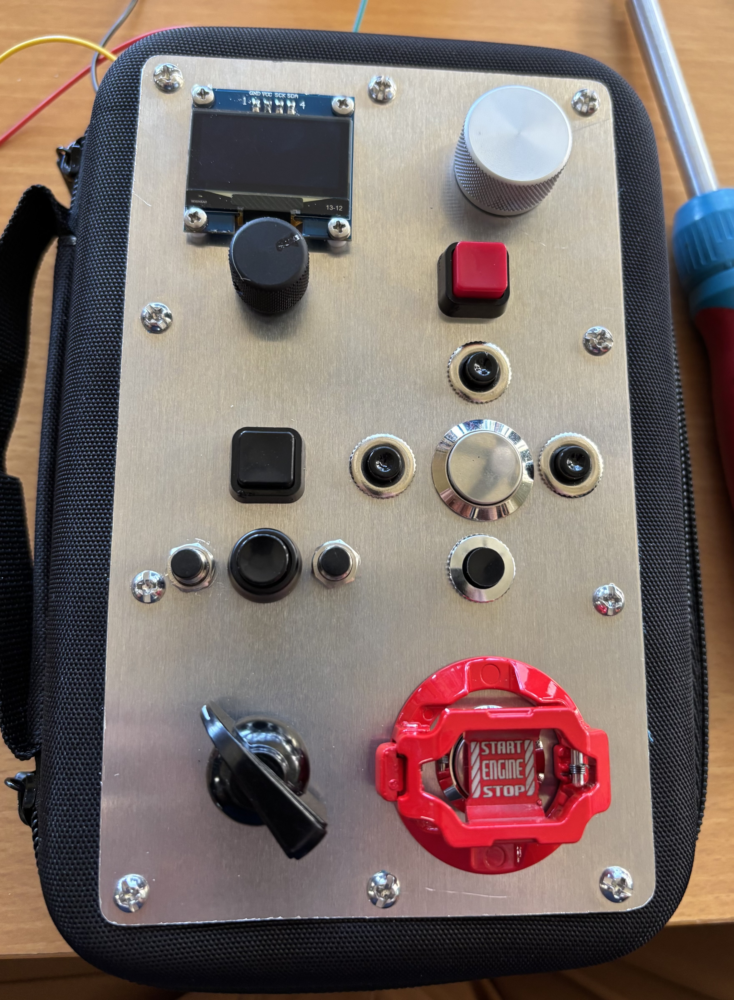
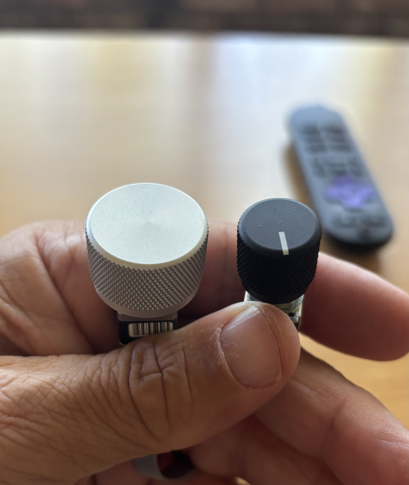
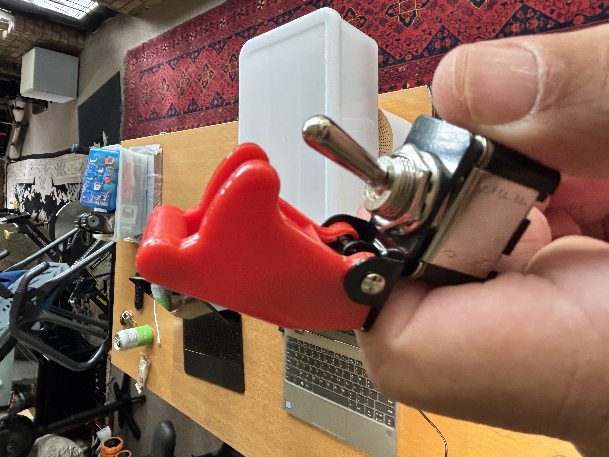
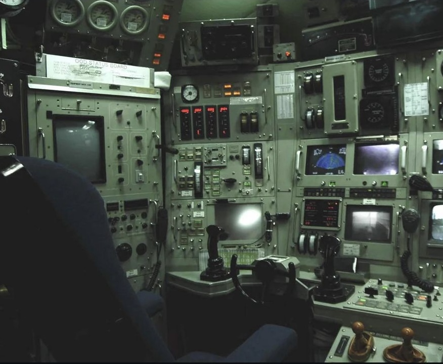
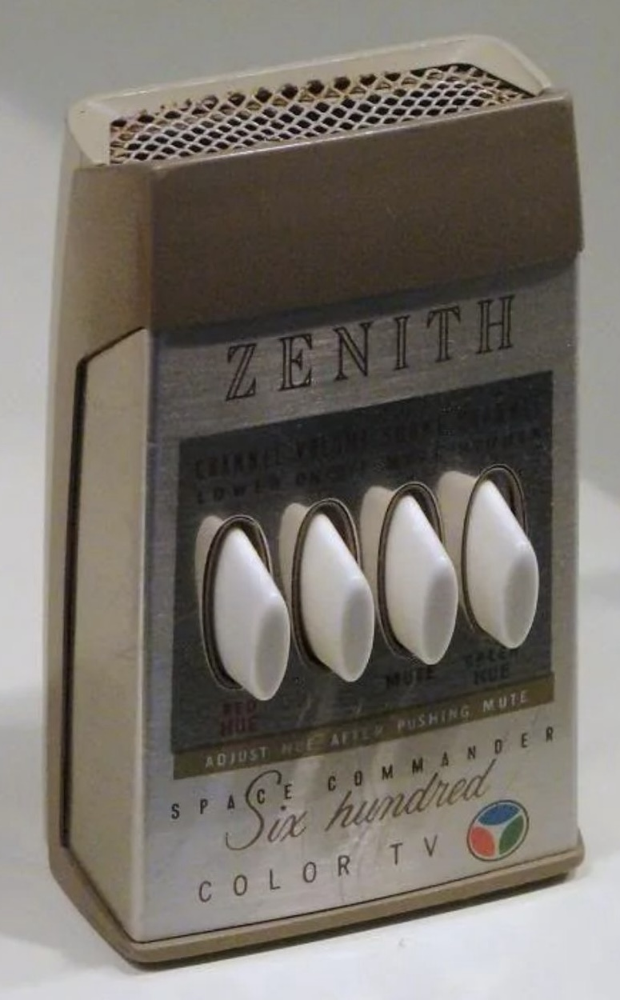
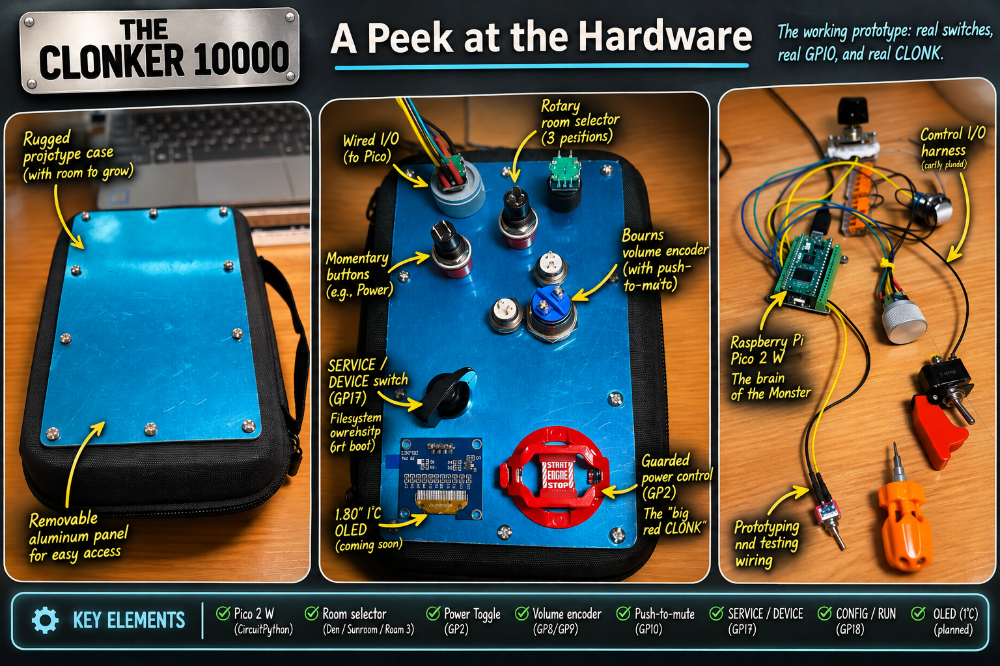
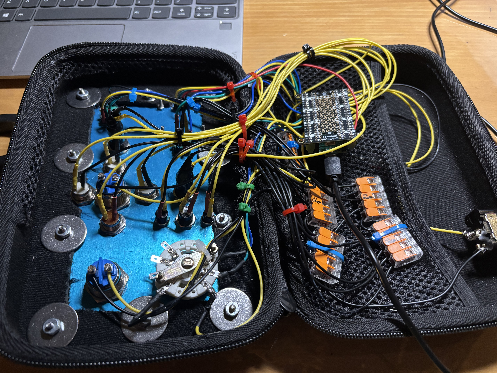
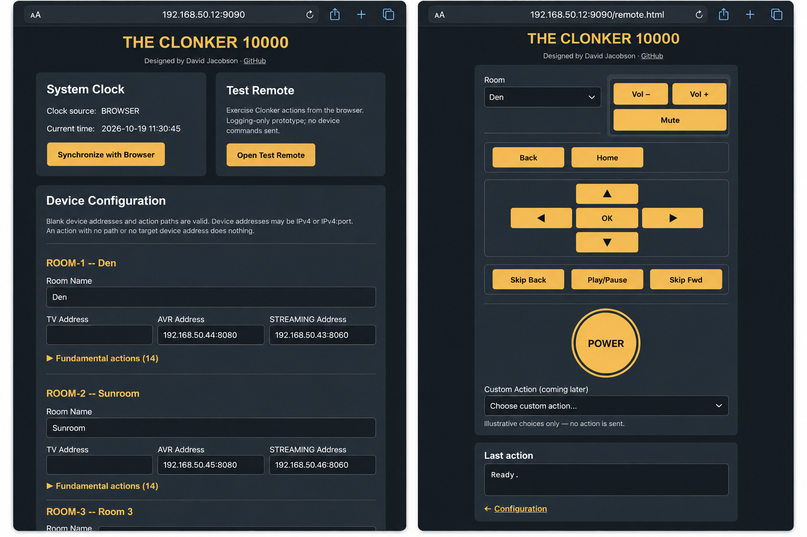
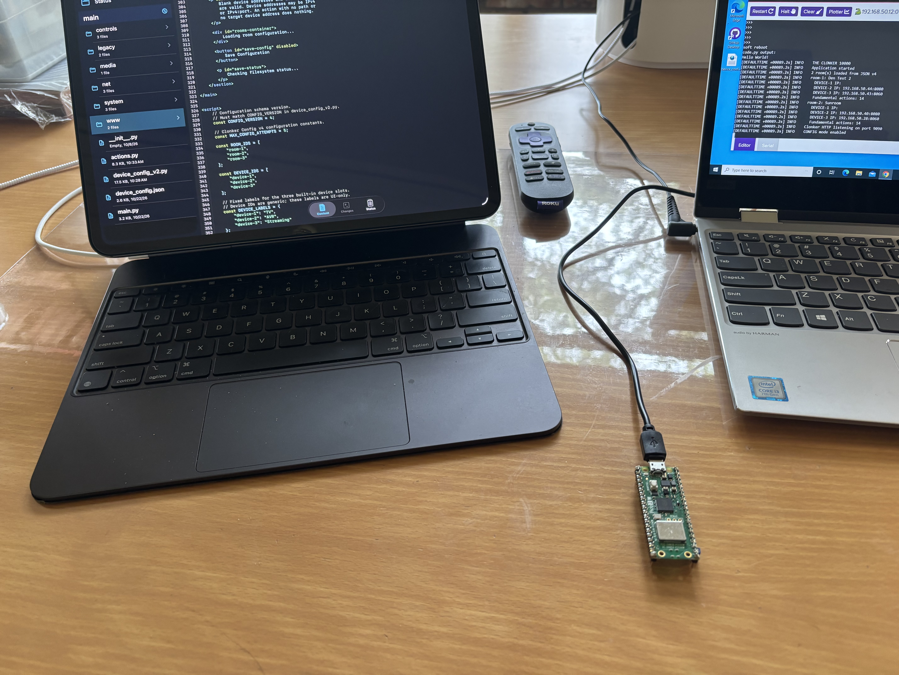

# THE CLONKER 10000

### Less sleek. More CLONK. ⚡🔩

**Extreme beta — an enthusiast-built home theater remote with an unreasonable appreciation for substantial metallic controls.**

<p align="center">
  
</p>

<p align="center">
  
  &nbsp;&nbsp;
  
</p>

**THE CLONKER 10000** is my DIY maker project to build the home theater and Hi-Fi remote control I've always wanted.

Fewer buttons. Bigger switches. Beautiful metallic knobs. Real tactile feedback. Modern Wi-Fi control.

And perhaps a case that opens with actual lunchbox latches.

*(Imagine a collection of magnificent controls mounted on a big-ass, honkin' enclosure, weighing somewhere between 0.5 and 10 pounds. Possibly steampunk-ish. Definitely not something that disappears between sofa cushions.)*

<p>
  <sub>
    <b>⚙️ CURRENT COMPATIBILITY — EXTREME BETA</b><br>
    <b>Controller:</b> Raspberry Pi Pico 2 W · CircuitPython 10.3.1<br>
    <b>Streaming:</b> Roku Ultra (working) · Apple TV (planned) · Amazon Fire TV (future possibility)<br>
    <b>Audio:</b> Denon AVRs (working) · Other network-capable AVRs (future)<br>
    <b>Televisions:</b> Direct LG, Samsung, TCL, and other TV control under consideration<br>
    <b>Configuration:</b> Browser editor · Config v4 · Custom actions<br>
    <b>Physical controls:</b> Room selector · Power · Volume/Mute · Navigation · Playback
  </sub>
</p>

---

## Why Does This Thing Exist?

I dislike modern remote controls.

Not because they're modern. I like modern technology.

I dislike the tiny, nearly indistinguishable rubber buttons, the obsession with sleekness, and the apparent assumption that everybody operates their television while staring directly at the remote.

**Humans are tactile beasts.**

I want to reach for my remote in pitch-black darkness, immediately recognize what I'm touching, and operate the important functions without looking.

I want my fingertips to encounter the kind of beautiful metallic knobs and substantial switches normally reserved for high-end Hi-Fi equipment, industrial control panels, and nuclear submarines.

Some vintage remotes came close.

<p align="center">
  
  &nbsp;&nbsp;
  
</p>

And when I press a button, I'd like my aging ears to hear a satisfying little **CLONK**.

Thus was born The Clonker 10000.

Because apparently the only way to get the remote I want is to build the damn thing myself.

---

## The Clonker Design Manifesto

**The Clonker 10000 is not a return to the past. It's a selective rescue operation.**

Once upon a time, remote controls had real buttons, satisfying mechanical feedback, and enough heft to remind you that you were holding an actual piece of equipment.

Unfortunately, they also had 117 buttons, six POWER switches, three mysterious INPUT selectors, and a row of controls nobody had touched since the Reagan administration.

Then came the modern remote: sleek, minimalist, and apparently designed for people with microscopic thumbs, perfect eyesight, and a deep emotional attachment to sponsored streaming services.

**The Clonker rejects the worst of both eras.**

We're keeping:

- Big, beautiful metallic switches and knobs.
- Fewer, thoughtfully chosen controls.
- Essential functions you can operate in complete darkness.
- Mechanical feedback that leaves no doubt something happened.
- Repairability and accessible internals.
- Modern Wi-Fi connectivity, configurable commands, and firmware updates.
- A healthy appreciation for vintage Hi-Fi equipment and nuclear submarines.

We're throwing overboard:

- The 117-button remote with six different POWER buttons.
- Microscopic rubber chiclets masquerading as controls.
- Sponsored streaming-service buttons.
- Sealed enclosures and microscopic proprietary screws.
- Complicated universal-remote programming rituals.
- Manufacturer IR code archaeology.
- Elaborate activity wizards that lose their minds when somebody manually changes an input.
- Anything designed primarily to look fabulous in a marketing photograph.

### The Harmony Memorial Department

I remember the Logitech Harmony era.

Those remotes were an ambitious attempt to bring order to the home theater industry's spectacular mess.

I respect the effort.

I also remember the configuration software.

The Clonker keeps the useful idea — one configurable controller for multiple devices — and leaves the infrared archaeology behind.

No hunting through 400 manufacturer codes. No teaching one remote to blink at another. No spending Saturday programming a *Watch TV* activity that gets confused when somebody turns the receiver on manually.

Our initial design uses network commands and readable configuration.

No IR is planned for the current version, although future optional support isn't ruled out.

**We want to watch the movie, not spend Saturday teaching the remote what a movie is.**

### Credit Where Credit Is Due

A respectful tip of the hat to companies making simplified, large-button remotes for seniors and people with accessibility needs.

They're addressing genuine problems, and I applaud them.

The Clonker isn't intended to replace or compete with those products.

I'm simply wondering why tactile, easy-to-find controls, sensible button counts, and straightforward operation shouldn't be desirable for *everybody*.

After all, you shouldn't have to qualify for a senior discount to get a volume button you can find in the dark.

**Accessibility isn't a niche feature. Sometimes it's just good engineering.**

### Serviceability Is a Feature

The enclosure should be something you can open, inspect, modify, and repair.

I'm seriously considering actual lunchbox-style latches.

And a real internal work light.

Because if servicing your remote requires three proprietary screwdrivers, reading glasses, tweezers, and holding a flashlight in your teeth, somebody has lost the plot.

These are design ideas, not completed hardware features.

**The Clonker isn't retro. It isn't minimalist. It's selectively maximalist.**

Maximum attention to the things that matter. Minimum tolerance for everything that doesn't.

---

## The Officially Unofficial Clonker Tagline Competition

The marketing department has been disbanded.

Unfortunately, nobody told them to stop submitting slogans.

The current finalists:

- **Less sleek. More CLONK.**
- **Six power buttons were five too many. Sponsored buttons are one too many.**
- **Our buttons are so big, the marketing department called them a safety hazard.**
- **No IR codes. No programming rituals. No HELP button to help the HELP button.**
- **[The Complete List](docs/TAGLINE_COMPETITION.md)** — Because apparently the disbanded marketing department didn't get the memo.

**Winner:** TBD. The selection committee is still arguing.

**Selection committee:** One engineer and an AI with questionable judgment.

**Marketing department:** Still disbanded.

---

## What Is the Clonker Actually Going to Do?

The Clonker is a configurable Wi-Fi remote for multiple home theater systems.

Instead of maintaining separate physical controls for every device, it sends generic actions to equipment selected through the current room's configuration.

### Fourteen Fundamental Actions

Each configured room supports the same fourteen action IDs:

| Function | Actions |
|---|---|
| Volume | Up, Down, Mute Toggle |
| Navigation | Up, Down, Left, Right, Select |
| Shortcuts | Back, Home |
| Playback | Play/Pause, Skip Back, Skip Forward |
| Power | Power Toggle |

Each action can target a configured television, AV receiver, or streaming device.

The current installation has three configured room entries:

- **Den:** Operational Denon AVR and Roku equipment.
- **Sunroom:** Operational Denon AVR and Roku equipment.
- **Room 3:** A configured placeholder for future expansion.

The physical room selector switches between them.

The third room is not a combined-room mode. Its device addresses and commands are currently blank.

### Custom Actions

The Clonker can also execute named sequences of configured commands.

For example, a *Movie* action might:

1. Send Home to the streaming device.
2. Wait a few seconds.
3. Select a receiver listening mode.

Custom actions are already operational through the browser Test Remote.

They use the same command queue as ordinary actions, so an unrelated eligible command can execute while a custom action is waiting.

The second rotary encoder is intended to make selecting and running these actions possible without opening the browser.

### Device Compatibility Roadmap

Current tested equipment includes:

- **Denon AV receivers**, using HTTP commands and persistent TCP for recognized volume actions.
- **Roku streaming devices**, using ECP commands, including held-key behavior.

**Apple TV support is an explicit future objective.**

Its discovery, pairing, authentication, and control requirements will be investigated when that development phase begins.

Other network-controllable TVs, receivers, and streaming devices may be considered later.

The goal is simple:

**The physical controls shouldn't care whether they're talking to a Denon, Roku, or something we haven't added yet.**

---

## A Peek at the Hardware

The Clonker 10000 is still very much a work in progress.

The knobs, switches, buttons, and assorted electronic organs are assembling into something that might eventually resemble a remote control.

Or possibly the control panel of a very small submarine.

<p align="center">
  
</p>

*Actual prototype. Industrial design department still missing. Marketing department still disbanded.*

---

## The Actual Hardware

The current controller is a **Raspberry Pi Pico 2 W (RP2350)** running **CircuitPython 10.3.1**.

<a href="images/clonker_nervous_system.jpeg">
  
</a>

A Pico Cowbell Terminal board provides screw-terminal GPIO connections, and a WAGO ground bus distributes common ground to the controls.

The physical build includes an aluminum faceplate, substantial controls, and a growing collection of wiring that would probably concern a minimalist industrial designer.

### Physical Controls

| Control | Current status |
|---|---|
| Three-position room selector | Operational |
| Momentary Power Toggle | Operational |
| Bourns volume encoder | Operational |
| Volume push-to-mute | Operational |
| Navigation Up/Down/Left/Right | Operational |
| Select / OK | Operational |
| Back and Home | Operational |
| Play/Pause | Operational |
| Skip Back / Skip Forward | Operational |
| Second Bourns encoder | Wired and electrically tested |
| SERVICE/DEVICE switch | Operational |
| CONFIG/RUN switch | Operational |

The volume encoder controls real equipment in two rooms using different network protocols.

The navigation and skip buttons support Roku keydown/keyup behavior, allowing a physical button to remain held rather than merely sending repeated individual keypresses.

The second Bourns encoder is intended for custom-action selection and execution.

### Still on the Workbench

- OLED status display.
- Audible CLONK feedback.
- Final internal wiring and strain relief.
- Enclosure finishing and assembly.
- Rechargeable power and sleep/wake behavior.
- Additional reliability testing.

The previously considered Grayhill volume encoder was set aside in favor of the Bourns units.

The Pico 2 W is the active firmware platform. An earlier ESP32-S3 Feather was part of the initial exploration, not the current implementation.

For component details, GPIO assignments, physical layout, and build decisions, see [Hardware & Physical Controls](docs/HARDWARE_CONTROLS.md).

---

## A Peek at the Software

The Clonker already has a browser-based configuration interface running directly on the Pico.

<p align="left">
  
</p>

There's also a browser Test Remote that exercises the same fundamental actions used by the physical controls.

It can run custom actions, test equipment commands, and help verify configuration before everything is permanently mounted in the enclosure.

The browser interface is primarily a configuration and development tool.

**The objective is to use the physical remote without needing the browser at all.**

---

## Software Architecture

<p align="center">
  
  <br>
  <sub>
    <b>The Clonker Brain</b> — A Raspberry Pi Pico 2 W,
    a little CircuitPython, and an unreasonable amount of ambition.
  </sub>
</p>

The software architecture is intentionally straightforward.

```text
       PHYSICAL CONTROLS       BROWSER TEST REMOTE
                |                      |
                v                      |
       Physical Coordinator            |
                |                      |
                +-----------+----------+
                            |
                            v
                     Action Dispatcher
                            |
                            v
                       DUMB QUEUE
                            |
                            v
                      Device Adapters
                            |
              +-------------+-------------+
              |             |             |
              v             v             v
          Denon TCP      Roku ECP      Generic HTTP
          Persistent     Held Keys      GET / POST
              |             |             |
              v             v             v
          Denon AVR        Roku       Other Commands
```

**Both input paths converge on the same action dispatcher and Dumb Queue™.**

Physical controls generate generic actions. The selected room's configuration determines which equipment receives them.

The queue schedules work, preserves applicable ordering, handles custom-action waits, and cancels pending commands after execution failures.

Device adapters select the appropriate transport.

- Denon volume uses persistent TCP with command pacing.
- Roku volume uses temporary ECP key holds.
- Six physical navigation and skip buttons use explicit Roku keydown/keyup.
- Other supported commands use generic HTTP.

Roku held-key cleanup is maintained cooperatively even after the last queued command finishes.

The Clonker does not claim to know the actual state of every connected device. It tracks commands, not reality.

And yes, the queue really is called the **Dumb Queue™**.

Because sometimes the smartest design decision is knowing when not to be clever.

For the engineering details, see [System Architecture](docs/ARCHITECTURE.md) and [Firmware & Network](docs/FIRMWARE_NETWORK.md).

### Configuration

The current **Clonker Config v4** system supports:

- One to three rooms.
- Three generic built-in device destinations per room.
- Fourteen fundamental actions per room.
- GET and POST command definitions.
- Separate configured power and mute paths.
- Named custom actions with ordered steps and waits.
- Revision checking and stale-edit protection.
- Validated saves, backups, and recovery.
- Intentional blank commands for ordinary actions.

Configuration is stored as JSON and edited through the browser.

The current Room 3 placeholder has blank equipment commands. Ordinary actions safely do nothing there; explicit Roku held-button dispatch still needs equivalent blank-command protection.

The configuration system is designed to avoid silently sending commands to another room when the selected room is unavailable.

See [Configuration & Recovery](docs/CONFIGURATION.md).

### Management Interface

The Pico hosts its management interface on port `9090` while CONFIG mode is enabled.

The interface provides configuration editing, Test Remote operation, custom-action execution, and clock synchronization.

The management service is intended for a trusted local network. It does not currently provide application-level authentication.

The firmware's CONFIG/RUN switch enables or disables the management interface without rebooting.

The separate SERVICE/DEVICE switch controls filesystem write ownership at boot.

See [Operating Modes](docs/OPERATING_MODES.md).

---

## Where the Monster Stands

**November 7, 2026 — Chapter 7 physical-controls milestone.**

The Clonker 10000 is still in extreme beta.

But it's no longer just a collection of ambitious electronics, colorful wires, and questionable design decisions.

**The Monster actually controls things now.**

### What's Alive ⚡

- **Three room positions:** Den, Sunroom, and a configured Room 3 placeholder.
- **Power at your fingertips:** Physical Power Toggle works in Den and Sunroom.
- **Jason Bourne has entered the building:** The Bourns volume encoder controls both rooms. Press to mute.
- **Two protocols, one knob:** Denon uses persistent TCP; Roku uses ECP held-volume.
- **Actual navigation:** Up, Down, Left, Right, Select, Back, and Home are integrated.
- **Playback controls:** Play/Pause and Skip Back/Forward are integrated.
- **Buttons that understand holding:** Six Roku navigation and skip buttons support explicit press/release behavior.
- **A working brain:** Wi-Fi, browser configuration, fourteen fundamental actions, custom actions, and the Dumb Queue™.
- **A more responsive workshop:** CONFIG-mode browser performance improved during Chapter 7 testing.

These are working firmware and physical-control capabilities, not just plans on a drawing board.

### What's Still on the Operating Table 🔧

- Complete the custom-action rotary interface.
- Bring the OLED display to life.
- Add satisfying audible CLONK feedback.
- Finish the enclosure, wiring, and power system.
- Investigate sleep/wake behavior.
- Improve reliability and failure recovery.
- Expand compatibility, including Apple TV.

### What's Next?

The second Bourns encoder is wired and waiting for its application-level role: selecting a configured custom action and pressing to execute it.

That should make the Clonker considerably more useful without touching the browser.

After that, the OLED and final hardware assembly can start making this thing look less like a bench experiment.

Or perhaps more like a bench experiment inside a very nice enclosure.

**The software talks to the equipment.**

**The switches talk to the software.**

**And Jason Bourne is now licensed to mute.**

*Less sleek. More CLONK.*

---

## Documentation

The project is documented as it develops, including architectural decisions, implementation details, testing, and the occasional embarrassing experiment.

| Document | Purpose |
|---|---|
| [Architecture](docs/ARCHITECTURE.md) | System design, component responsibilities, and boundaries |
| [Hardware & Physical Controls](docs/HARDWARE_CONTROLS.md) | Components, GPIO, wiring, and physical design |
| [Configuration](docs/CONFIGURATION.md) | Config v4 schema, validation, and recovery |
| [Firmware & Network](docs/FIRMWARE_NETWORK.md) | Networking, adapters, scheduler, and diagnostics |
| [Operating Modes](docs/OPERATING_MODES.md) | SERVICE/DEVICE and CONFIG/RUN |
| [Development](docs/DEVELOPMENT.md) | Development and deployment workflow |
| [Development History](docs/DEVELOPMENT_HISTORY.md) | Chronological milestones and test evidence |
| [Chapter 2 Handoff](docs/CHAPTER_2_HANDOFF.md) | Historical development baseline |

This is a personal, experimental maker project, not a finished commercial product.

The documentation distinguishes implemented features from planned work and historical experiments.

---

## The Grand Objective

Build a remote that combines the best of the shamefully forgotten past with the carefully curated best of the present.

Keep the beautiful controls.

Keep the modern electronics.

Keep the software flexibility.

Throw away the button farms, the rubber chiclets, the programming rituals, the sealed plastic, and the sponsored nonsense.

And maybe install a couple of lunchbox latches.

**THE CLONKER 10000**

**Less sleek. More CLONK.**

**CLONK! ⚡🔩**

*Designed by David Jacobson. Marketing department not consulted.*
