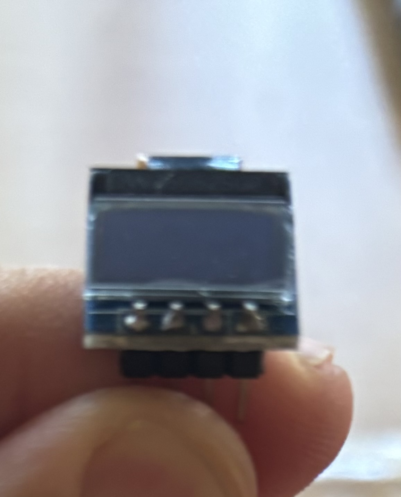
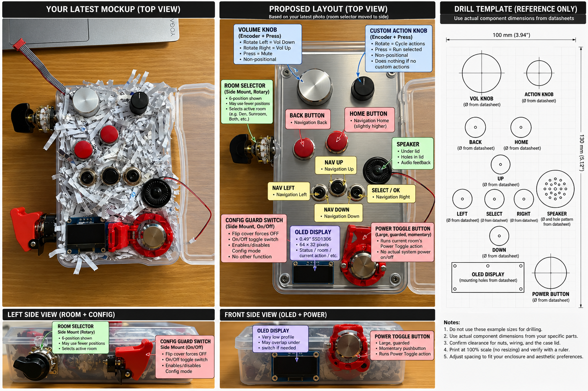

# THE CLONKER 10000

### Less sleek. More CLONK. ⚡🔩

**Extreme beta — an enthusiast-built home theater remote with an unreasonable appreciation for substantial metallic controls.**

<p align="center">
  
</p>

<p align="center">
  
  &nbsp;&nbsp;
  
</p>

**THE CLONKER 10000** is my DIY maker project to build the home theater and Hi-Fi remote control I've always wanted.

Fewer buttons. Bigger switches. Beautiful metallic knobs. Real tactile feedback. Modern Wi-Fi control.

And perhaps a case that opens with actual lunchbox latches.

*(For now, imagine those magnificent controls mounted on a big-ass, honkin' brick of an enclosure, weighing somewhere between 0.5 and 10 pounds. Possibly steampunk-ish. Definitely not something that disappears between sofa cushions.)*

<p>
  <sub>
    <b>⚙️ CURRENT COMPATIBILITY — EXTREME BETA</b><br>
    <b>Controller:</b> Raspberry Pi Pico 2 W · CircuitPython<br>
    <b>Streaming:</b> Roku Ultra (working) · Apple TV (planned) · Amazon Fire TV (future)<br>
    <b>Audio:</b> Denon AVRs (working) · Other network-capable AVRs (future)<br>
    <b>Televisions:</b> Direct LG, Samsung, TCL, and other TV control under consideration<
    <b>Configuration:</b> Browser editor · HTTP and Denon TCP control · Executable custom actions<br>
    <b>Physical controls:</b> Room selector · Power Toggle · Rotary volume encoder operational
  </sub>
</p>

---

## Why Does This Thing Exist?

I dislike modern remote controls.

Not because they're modern. I like modern technology.

I dislike the tiny, nearly indistinguishable rubber buttons, the obsession with sleekness, and the apparent assumption that everybody operates their television while staring directly at the remote.

Humans are tactile beasts.

I want to reach for my remote in pitch-black darkness, immediately recognize what I'm touching, and operate the important functions without looking.

I want my fingertips to encounter the kind of beautiful metallic knobs and substantial switches normally reserved for high-end Hi-Fi equipment, industrial control panels, and nuclear submarines.

Some vintage remotes came close.

<p align="center">
  
  &nbsp;&nbsp;
  
</p>

And when I press a button, I'd like my aging ears to hear a satisfying little **CLONK**.

Thus was born The Clonker 10000.

Because apparently the only way to get the remote I want is to build the damn thing myself.

---

## The Clonker Design Manifesto

**The Clonker 10000 is not a return to the past. It's a selective rescue operation.**

Once upon a time, remote controls had real buttons, satisfying mechanical feedback, and enough heft to remind you that you were holding an actual piece of equipment.

Unfortunately, they also had 117 buttons, six POWER switches, three mysterious INPUT selectors, and a row of controls nobody had touched since the Reagan administration.

Then came the modern remote: sleek, minimalist, and apparently designed for people with microscopic thumbs, perfect eyesight, and a deep emotional attachment to sponsored streaming services.

**The Clonker rejects the worst of both eras.**

We're keeping:

- Big, beautiful metallic switches and knobs.
- Fewer, thoughtfully chosen controls.
- Essential functions you can operate in complete darkness.
- Mechanical feedback that leaves no doubt something happened.
- Repairability and accessible internals.
- Modern Wi-Fi connectivity, configurable commands, and firmware updates.
- A healthy appreciation for vintage Hi-Fi equipment and nuclear submarines.

We're throwing overboard:

- The 117-button remote with six different POWER buttons.
- Microscopic rubber chiclets masquerading as controls.
- Sponsored streaming-service buttons.
- Sealed enclosures and microscopic proprietary screws.
- Complicated universal-remote programming rituals.
- Manufacturer IR code archaeology.
- Elaborate activity wizards that lose their minds when somebody manually changes an input.
- Anything designed primarily to look fabulous in a marketing photograph.

### The Harmony Memorial Department

I remember the Logitech Harmony era.

Those remotes were an ambitious attempt to bring order to the home theater industry's spectacular mess.

I respect the effort.

I also remember the configuration software.

The Clonker keeps the useful idea — one configurable controller for multiple devices — and leaves the infrared archaeology behind.

No hunting through 400 manufacturer codes. No teaching one remote to blink at another. No spending Saturday programming a *Watch TV* activity that gets confused when somebody turns the receiver on manually.

Our initial design uses network commands and readable configuration.

No IR is planned for the current version, although future optional support isn't ruled out.

**We want to watch the movie, not spend Saturday teaching the remote what a movie is.**

### Credit Where Credit Is Due

A respectful tip of the hat to companies making simplified, large-button remotes for seniors and people with accessibility needs.

They're addressing genuine problems, and I applaud them.

The Clonker isn't intended to replace or compete with those products.

I'm simply wondering why tactile, easy-to-find controls, sensible button counts, and straightforward operation shouldn't be desirable for *everybody*.

After all, you shouldn't have to qualify for a senior discount to get a volume button you can find in the dark.

**Accessibility isn't a niche feature. Sometimes it's just good engineering.**

### Serviceability Is a Feature

The enclosure should be something you can open, inspect, modify, and repair.

I'm seriously considering actual lunchbox-style latches.

And a real internal work light.

Because if servicing your remote requires three proprietary screwdrivers, reading glasses, tweezers, and holding a flashlight in your teeth, somebody has lost the plot.

These are design ideas, not completed hardware features.

**The Clonker isn't retro. It isn't minimalist. It's selectively maximalist.**

Maximum attention to the things that matter. Minimum tolerance for everything that doesn't.

---

## The Officially Unofficial Clonker Tagline Competition

The marketing department has been disbanded.

Unfortunately, nobody told them to stop submitting slogans.

The current finalists:

- **Less sleek. More CLONK.**
- **Six power buttons were five too many. Sponsored buttons are one too many.**
- **Our buttons are so big, the marketing department called them a safety hazard.**
- **No IR codes. No programming rituals. No HELP button to help the HELP button.**
- **[The Complete List](docs/TAGLINE_COMPETITION.md)** — Because apparently the disbanded marketing department didn't get the memo.

**Winner:** TBD. The selection committee is still arguing.

**Selection committee:** One engineer and an AI with questionable judgment.

**Marketing department:** Still disbanded.

---

## What Is the Clonker Actually Going to Do?

The Clonker is being developed as a configurable Wi-Fi remote for multiple home theater systems.

The goal is to control everyday functions through a small number of physical controls rather than a forest of device-specific buttons.

### Fundamental actions

Each configured room supports fourteen standard action IDs:

| Function | Actions |
|---|---|
| Volume | Up, Down, Mute Toggle |
| Navigation | Up, Down, Left, Right, Select |
| Navigation shortcuts | Back, Home |
| Playback | Play/Pause, Skip Back, Skip Forward |
| Power | Power Toggle |

Each action can be mapped to a configured TV, AV receiver, or streaming device.

Clonker Config v4 supports up to three rooms, each with its own devices and command mappings. The current installation configures Den and Sunroom.

**Custom actions are operational in firmware.** They can combine ordered device commands and cooperative waits for equipment-specific functions such as listening modes or a simple movie-start sequence.

The browser Test Remote can execute custom actions today.

The physical room selector, Power Toggle, and Bourns volume encoder are operational. The custom-action encoder and remaining physical controls are still being integrated.

### Device Compatibility Roadmap

Clonker's current, tested network-control targets are Denon AV receivers and Roku streaming devices.

**Apple TV support is an explicit future project objective.** The long-term goal is to support Apple TV alongside Roku through the same fundamental Clonker actions, without requiring different physical controls.

Other network-controllable TVs, receivers, and streaming devices may be considered as the project develops.

Apple TV support has not yet been implemented or tested. Its protocol, pairing, authentication, and integration requirements will be investigated when that development phase begins.

**The goal is simple: the physical controls shouldn't care whether they're talking to a Denon, Roku, or something we haven't added yet.**

---

## The Hardware

The current controller is a **Raspberry Pi Pico 2 W (RP2350)** running **CircuitPython 10.3.1**.

A Pico Cowbell Terminal board provides screw-terminal GPIO connections, and a WAGO ground bus distributes common ground to the controls.

### Physical controls already verified

- **GP17 SERVICE/DEVICE switch:** Selects USB filesystem ownership or firmware write access at boot. Requires a complete power cycle to change modes.
- **GP18 CONFIG/RUN switch:** Enables or disables the browser management listener live, without rebooting.
- **GP3/GP6/GP7 rotary room selector:** Selects Den, Sunroom, or reserved Room 3. Integrated with firmware and verified after GPIO reassignment.
- **GP2 momentary Power Toggle:** Dispatches the selected room's configured power action. Actual ON/OFF equipment behavior verified in Den and Sunroom.
GP4/GP5 are reserved for the Cowbell's STEMMA QT/I²C connector, potentially for the planned OLED status display.
- **GP8/GP9 Bourns volume encoder:** Physical rotation dispatches room-aware volume commands. Slow, moderate, and aggressive rotation verified against the Sunroom Denon.

### Hardware still being integrated

- **Bourns PEC11R volume encoder:** Rotation is integrated and operational; push-to-mute remains pending.
- **Second Bourns PEC11R encoder:** Planned for custom-action selection and push-to-run.
- Substantial tactile navigation and shortcut buttons.
- Tiny OLED status display.
- Optional piezo or I2S-powered audible feedback.
- Rechargeable power.
- Final enclosure and aluminum faceplate.

The working Bourns encoder is now the selected volume-control hardware. The previously considered Grayhill encoder is being saved for another project.

The Pico 2 W is the active development platform.

An earlier ESP32-S3 Feather board was part of the original hardware exploration but is not the current firmware target.

**Hardware reality check:** Room selection, Power Toggle, and rotary volume control now work against actual home-theater equipment. The complete control panel is still under construction.

See [Hardware & Physical Controls](docs/HARDWARE_CONTROLS.md) for the detailed inventory, proposed layout, GPIO status, and ongoing design decisions.

---

## A Peek at the Hardware

The Clonker 10000 is still very much a work in progress.

The final enclosure hasn't materialized yet, but the knobs, switches, and assorted electronic organs are beginning to assemble into something that might eventually resemble a remote control.

Or possibly the control panel of a very small submarine.

<p align="center">
  
</p>

*Actual prototype. Industrial design department still missing. Marketing department still disbanded.*

---

## A Peek at the Software

The configuration interface already exists and runs on the Pico.

<p align="left">
  
</p>

The project also includes a browser Test Remote for exercising the same fourteen fundamental action IDs that physical controls invoke.

It can also run configured custom actions, including multi-step sequences across different devices.

This allows the software architecture to be tested before committing to the final enclosure and GPIO wiring arrangement.

**The first rotary knob is operational!** The physical Bourns volume encoder now controls the Denon through a persistent TCP connection. The Monster has learned to turn things up without waiting for an HTTP connection on every click.

---

## Software Architecture

<p align="center">
  
  <br>
  <sub>
    <b>The Clonker Brain</b> — A Raspberry Pi Pico 2 W,
    a little CircuitPython, and an unreasonable amount of ambition.
  </sub>
</p>

The Clonker uses a small, intentionally straightforward software architecture.

```text
Physical GPIO inputs             Browser Test Remote
  (room selector, buttons,             |
   volume encoder)                     |
         |                             v
         v                       HTTP action API
  Physical coordinator                 |
         |                             |
         v                             |
  Room-aware dispatch                  |
         |                             |
         +---------------+-------------+
                         |
                         v
                  Action dispatcher
                         |
                         v
                    DUMB QUEUE
                         |
                         v
              Cached adapter selection
                         |
                  +------+------+
                  |             |
                  v             v
             Generic HTTP    Denon TCP
              transport       adapter
                  |             |
                  v             v
             Roku / AVR      Denon AVR
               commands       volume
```

**Both input paths converge on the same action dispatcher and Dumb Queue™.**

The physical room selector establishes context. Buttons and encoder movements produce generic actions that are resolved using the selected room's configuration.

Room 3 is reserved. If selected without a configured room, physical action dispatch safely does nothing.

The queue preserves command ordering, schedules delayed work, and cancels pending commands when execution fails.

A device-adapter resolver recognizes supported fundamental-command patterns. Its selections are cached when configuration is loaded or successfully changed, rather than repeatedly analyzing the commands during execution.

Currently, recognized Denon volume-up and volume-down commands use a persistent TCP connection with 50 ms minimum transmission spacing. Other commands retain the existing generic HTTP transport.

The adapter architecture allows additional device protocols to be introduced without making the queue responsible for manufacturer-specific behavior.

Custom actions reuse the same queue and currently execute through the existing HTTP transport. Cooperative waits permit unrelated eligible commands to execute while a custom action is delayed.

Outbound HTTP remains synchronous and blocking. The Denon TCP adapter also uses synchronous socket operations, but avoids repeatedly establishing connections for individual volume commands.

The architecture has been verified with actual equipment, physical encoder operation, mixed HTTP/TCP command ordering, delayed custom actions, and failure-cancellation regression tests.

### Configuration

Configuration is stored in JSON and edited through the Clonker's browser interface.

The current **Clonker Config v4** system supports:

- One to three configured rooms using supported stable IDs; the current sample configures Den and Sunroom.
- TV, AVR, and streaming-device endpoints per room.
- IPv4 addresses with optional HTTP ports.
- Fourteen fundamental actions per room.
- GET and POST command definitions.
- Separate ON and OFF command paths for mute and power toggles.
- Volatile, independent toggle command-direction histories per room and action.
- Blank commands as intentional no-ops.
- Up to sixteen named custom actions per room, each containing one to sixteen ordered steps.
- Cooperative waits between custom-action steps.
- Configuration revision checking.
- Stale-edit conflict protection.
- No-change detection.
- Rotating backups.
- Validated startup recovery.
- Filesystem write protection during USB SERVICE mode.

**Runtime toggle direction selection is implemented and tested.** The next ON/OFF direction advances only after a successful HTTP request.

It is command history, not authoritative knowledge of the equipment's actual power or mute state.

### Management Interface

The Pico hosts a browser-based configuration and testing interface on port `9090` while in CONFIG mode.

The interface currently provides:

- JSON configuration editing.
- Device and room settings.
- Configuration save and validation.
- A Test Remote with all fourteen fundamental actions.
- Room-specific custom-action selection and execution.
- A clock synchronization interface.
- SERVICE/DEVICE filesystem ownership protection.

The browser Test Remote and physical controls use the same shared action dispatcher and Dumb Queue™.

**Real network control is operational.** The Pico executes configured Roku and Denon HTTP commands, while recognized Denon fundamental volume commands use a persistent TCP connection.

The browser receives an acknowledgment when an action is queued. Actual device execution occurs subsequently through the cooperative scheduler.

Chapter 6 connected the physical room selector, Power Toggle, and Bourns volume encoder to this shared execution path.

The remaining physical controls can reuse the established architecture rather than introducing another execution mechanism.

---

## Project Status

**November 3, 2026 — Chapter 6: Physical volume control and device adapters operational.**

Extreme beta, but the Monster now has working physical room selection, Power Toggle, and a rotary volume knob that controls real Denon receivers.

### Working and tested

**Core firmware and configuration**

- Raspberry Pi Pico 2 W running CircuitPython 10.3.1.
- Wi-Fi connectivity and browser management interface.
- Clonker Config v4 JSON configuration, validation, persistence, and recovery.
- Revision checking, stale-edit rejection, no-change detection, and rotating backups.
- Browser Test Remote supporting fourteen fundamental actions and custom actions.
- Shared Dumb Queue™ with cooperative scheduling, delayed tasks, and failure cancellation.
- Independent runtime power/mute toggle command histories.
- Blank fundamental commands treated as intentional no-ops.

**Physical controls**

- GP17 SERVICE/DEVICE switch for filesystem ownership.
- GP18 CONFIG/RUN switch for application management mode.
- Three-position physical room selector for Den, Sunroom, and reserved Room 3.
- Safe no-op when the selected room is not configured.
- GP2 momentary Power Toggle, verified against actual equipment in both rooms.
- Bourns PEC11R rotary encoder integrated as the physical volume control.
- Physical encoder events routed through the same action dispatcher as the browser Test Remote.
- Slow, moderate, and aggressive encoder rotation exercised successfully against the Sunroom Denon.

**Networking and device adapters**

- Existing bounded HTTP GET/POST transport for Roku and other configured commands.
- Device-adapter selection derived from recognized fundamental-command patterns.
- Cached adapter selections rebuilt during successful configuration loading and saving.
- Generic HTTP fallback for commands without a specialized adapter.
- Persistent Denon TCP transport for recognized volume-up and volume-down commands.
- Cooperative, nonblocking 50 ms minimum interval between Denon TCP volume transmissions.
- TCP connection reuse and switching between the two configured Denon receivers.
- No automatic retry of commands whose transmission outcome is uncertain.

**Verified integration and regression behavior**

- Five volume-up and five volume-down commands executed through the Dumb Queue™ and Denon TCP, returning the receiver to its starting volume.
- Physical encoder tested with five slow detents in each direction.
- Moderate and aggressive encoder rotation produced responsive, smooth volume changes.
- Mixed HTTP/TCP command ordering preserved.
- Denon pacing holds an eligible command without allowing later commands to overtake it.
- Future-dated commands do not prevent unrelated immediate commands from executing.
- Delayed custom-action steps allow other eligible commands to run during their wait.
- Execution failures discard pending queue work.
- Successful configuration saves update the adapter cache; rejected stale saves leave it unchanged.
- Production configuration restoration and disposable-test cleanup verified.

### Not yet implemented or fully tested

- Physical volume-encoder push-to-mute.
- Second encoder for custom-action selection and execution.
- Navigation, Home/Back, and playback buttons.
- OLED display and audible feedback.
- Final enclosure, aluminum faceplate, and rechargeable power architecture.
- Deep-sleep ignition and wake behavior.
- Apple TV pairing, authentication, and control.
- Additional device adapters and configurable adapter overrides.
- Denon TCP response parsing and unsolicited-status handling.
- Comprehensive network-disconnect and receiver-restart recovery tests.
- Long-duration stability and sustained high-rate workloads.

### Engineering decisions

The working Bourns encoder is the current volume-control choice. The previously considered Grayhill encoder is reserved for another project.

No volume batching or software acceleration is currently required. The physical knob already provides smooth, responsive control using ordinary encoder events and paced TCP commands.

The Dumb Queue™ remains intentionally simple. Device-specific protocol details belong in adapters, not in the generic action scheduler.

Custom actions continue to use the existing HTTP transport. The current Denon TCP specialization applies only to recognized fundamental volume commands.

### Next milestone

Complete the remaining physical controls, document the new adapter architecture, and investigate reliability under network failures and prolonged operation.

The software talks to the equipment.

The switches talk to the software.

**And now the volume knob talks to the Denon—without making us wait for HTTP on every click.**

Less sleek. More CLONK.

---

## Documentation

The project is being documented as it develops, including decisions, testing, and implementation boundaries.

| Document | Purpose |
|---|---|
| [Architecture](docs/ARCHITECTURE.md) | Overall system design and implementation boundaries |
| [Hardware & Physical Controls](docs/HARDWARE_CONTROLS.md) | Physical controls, component inventory, and design manifesto |
| [Configuration](docs/CONFIGURATION.md) | Config v4 JSON schema, validation, and recovery |
| [Firmware & Network](docs/FIRMWARE_NETWORK.md) | HTTP API, networking, and clock behavior |
| [Operating Modes](docs/OPERATING_MODES.md) | SERVICE/DEVICE and CONFIG/RUN |
| [Development](docs/DEVELOPMENT.md) | Development and deployment workflow |
| [Development History](docs/DEVELOPMENT_HISTORY.md) | Major milestones in Clonker development |
| [Chapter 2 Handoff](docs/CHAPTER_2_HANDOFF.md) | Historical Chapter 2 handoff and development baseline |

This is a personal, experimental maker project, not a finished commercial product.

The documentation is intended to distinguish implemented behavior from ideas, prototypes, and future plans.

---

## The Grand Objective

Build a remote that combines the best of the shamefully forgotten past with the carefully curated best of the present.

Keep the beautiful controls.

Keep the modern electronics.

Keep the software flexibility.

Throw away the button farms, the rubber chiclets, the programming rituals, the sealed plastic, and the sponsored nonsense.

And maybe install a couple of lunchbox latches.

**THE CLONKER 10000**

**Less sleek. More CLONK.**

**CLONK! ⚡🔩**

*Designed by David Jacobson. Marketing department not consulted.*
