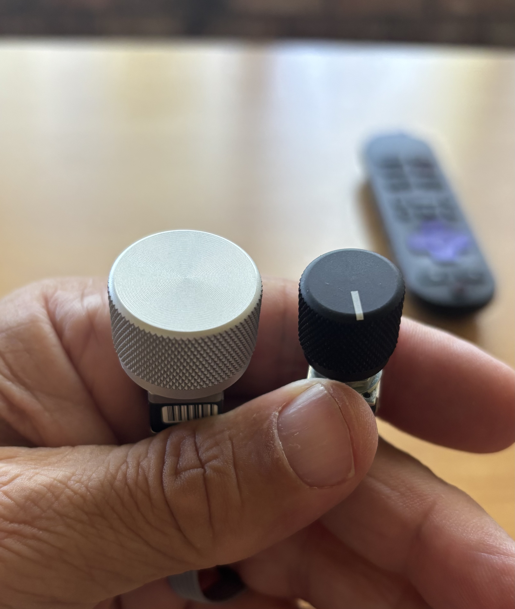
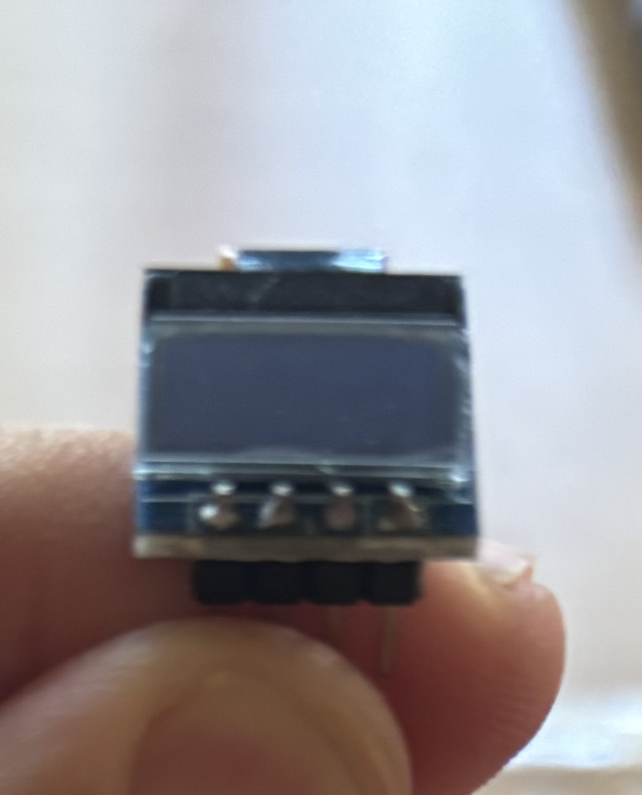
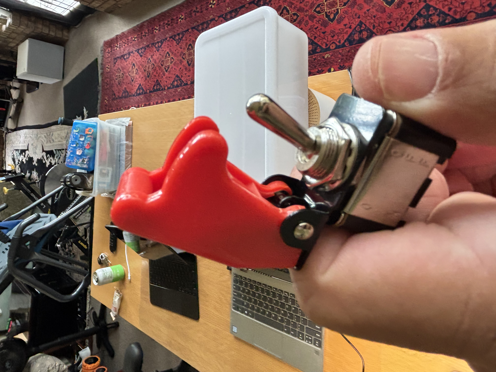
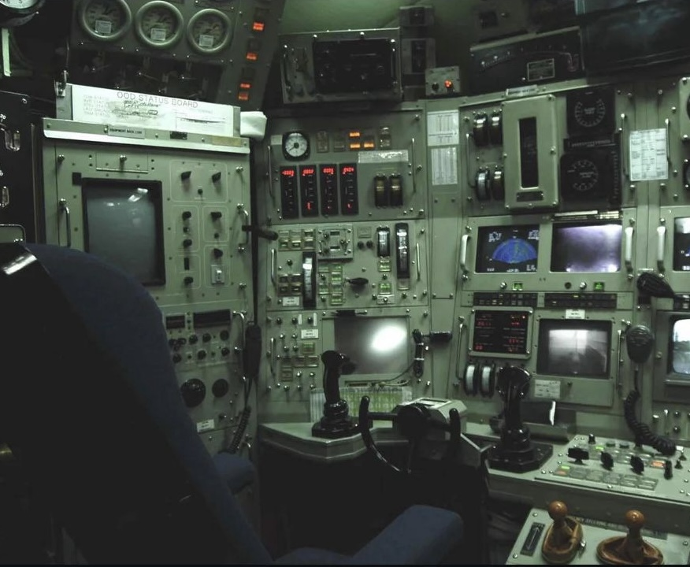
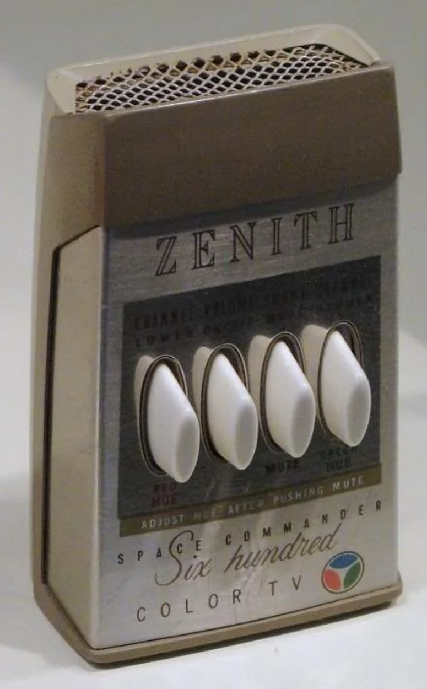
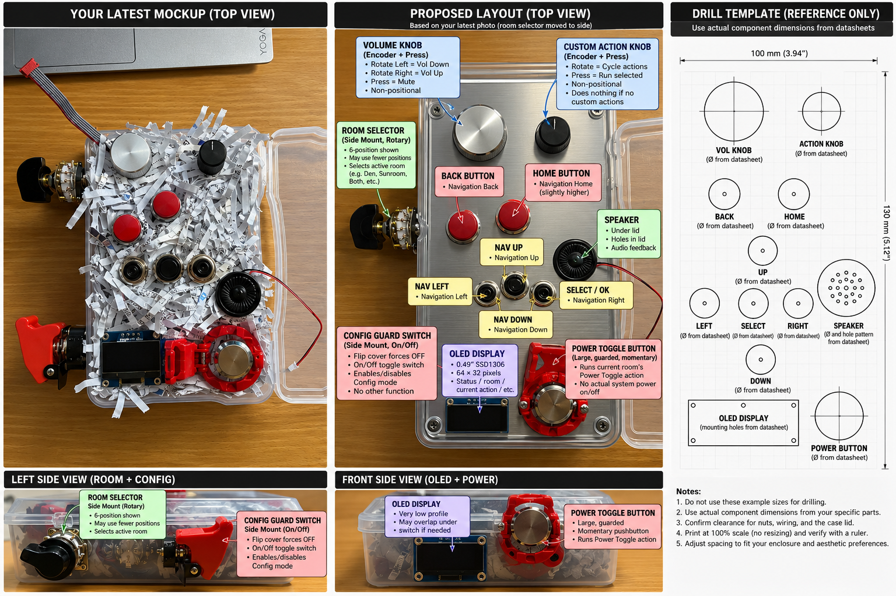
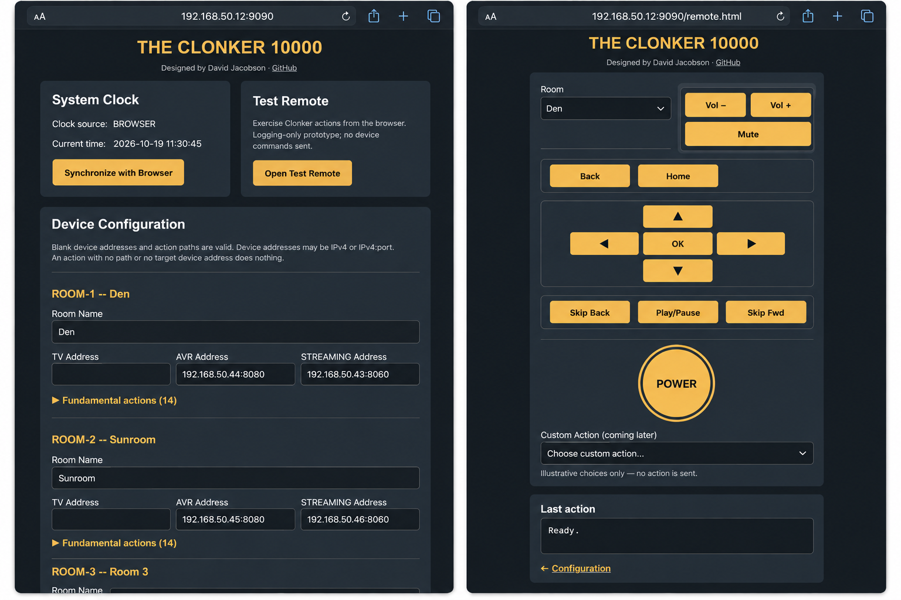
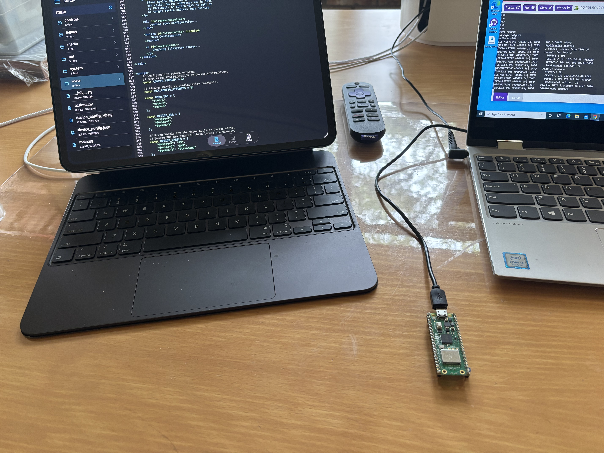

# THE CLONKER 10000

### Less sleek. More CLONK. ⚡🔩

**Extreme beta — an enthusiast-built home theater remote with an unreasonable appreciation for substantial metallic controls.**

<p align="center">
  
</p>

<p align="center">
  
  &nbsp;&nbsp;
  
</p>

**THE CLONKER 10000** is my DIY maker project to build the home theater and Hi-Fi remote control I've always wanted.

Fewer buttons. Bigger switches. Beautiful metallic knobs. Real tactile feedback. Modern Wi-Fi control.

And perhaps a case that opens with actual lunchbox latches.

*(For now, imagine those magnificent controls mounted on a big-ass, honkin' brick of an enclosure, weighing somewhere between 0.5 and 10 pounds. Possibly steampunk-ish. Definitely not something that disappears between sofa cushions.)*

<p>
  <sub>
    <b>⚙️ CURRENT COMPATIBILITY — EXTREME BETA</b><br>
    <b>Controller:</b> Raspberry Pi Pico 2 W · CircuitPython<br>
    <b>Streaming:</b> Roku Ultra (working) · Apple TV (planned) · Amazon Fire TV (future)<br>
    <b>Audio:</b> Denon AVRs (working) · Other network-capable AVRs (future)<br>
    <b>Televisions:</b> Direct LG, Samsung, TCL, and other TV control under consideration<br>
    <b>Configuration:</b> Browser-based editor · Wi-Fi HTTP commands · Executable custom action sequences
  </sub>
</p>

---

## Why Does This Thing Exist?

I dislike modern remote controls.

Not because they're modern. I like modern technology.

I dislike the tiny, nearly indistinguishable rubber buttons, the obsession with sleekness, and the apparent assumption that everybody operates their television while staring directly at the remote.

Humans are tactile beasts.

I want to reach for my remote in pitch-black darkness, immediately recognize what I'm touching, and operate the important functions without looking.

I want my fingertips to encounter the kind of beautiful metallic knobs and substantial switches normally reserved for high-end Hi-Fi equipment, industrial control panels, and nuclear submarines.

Some vintage remotes came close.

<p align="center">
  
  &nbsp;&nbsp;
  
</p>

And when I press a button, I'd like my aging ears to hear a satisfying little **CLONK**.

Thus was born The Clonker 10000.

Because apparently the only way to get the remote I want is to build the damn thing myself.

---

## The Clonker Design Manifesto

**The Clonker 10000 is not a return to the past. It's a selective rescue operation.**

Once upon a time, remote controls had real buttons, satisfying mechanical feedback, and enough heft to remind you that you were holding an actual piece of equipment.

Unfortunately, they also had 117 buttons, six POWER switches, three mysterious INPUT selectors, and a row of controls nobody had touched since the Reagan administration.

Then came the modern remote: sleek, minimalist, and apparently designed for people with microscopic thumbs, perfect eyesight, and a deep emotional attachment to sponsored streaming services.

**The Clonker rejects the worst of both eras.**

We're keeping:

- Big, beautiful metallic switches and knobs.
- Fewer, thoughtfully chosen controls.
- Essential functions you can operate in complete darkness.
- Mechanical feedback that leaves no doubt something happened.
- Repairability and accessible internals.
- Modern Wi-Fi connectivity, configurable commands, and firmware updates.
- A healthy appreciation for vintage Hi-Fi equipment and nuclear submarines.

We're throwing overboard:

- The 117-button remote with six different POWER buttons.
- Microscopic rubber chiclets masquerading as controls.
- Sponsored streaming-service buttons.
- Sealed enclosures and microscopic proprietary screws.
- Complicated universal-remote programming rituals.
- Manufacturer IR code archaeology.
- Elaborate activity wizards that lose their minds when somebody manually changes an input.
- Anything designed primarily to look fabulous in a marketing photograph.

### The Harmony Memorial Department

I remember the Logitech Harmony era.

Those remotes were an ambitious attempt to bring order to the home theater industry's spectacular mess.

I respect the effort.

I also remember the configuration software.

The Clonker keeps the useful idea — one configurable controller for multiple devices — and leaves the infrared archaeology behind.

No hunting through 400 manufacturer codes. No teaching one remote to blink at another. No spending Saturday programming a *Watch TV* activity that gets confused when somebody turns the receiver on manually.

Our initial design uses network commands and readable configuration.

No IR is planned for the current version, although future optional support isn't ruled out.

**We want to watch the movie, not spend Saturday teaching the remote what a movie is.**

### Credit Where Credit Is Due

A respectful tip of the hat to companies making simplified, large-button remotes for seniors and people with accessibility needs.

They're addressing genuine problems, and I applaud them.

The Clonker isn't intended to replace or compete with those products.

I'm simply wondering why tactile, easy-to-find controls, sensible button counts, and straightforward operation shouldn't be desirable for *everybody*.

After all, you shouldn't have to qualify for a senior discount to get a volume button you can find in the dark.

**Accessibility isn't a niche feature. Sometimes it's just good engineering.**

### Serviceability Is a Feature

The enclosure should be something you can open, inspect, modify, and repair.

I'm seriously considering actual lunchbox-style latches.

And a real internal work light.

Because if servicing your remote requires three proprietary screwdrivers, reading glasses, tweezers, and holding a flashlight in your teeth, somebody has lost the plot.

These are design ideas, not completed hardware features.

**The Clonker isn't retro. It isn't minimalist. It's selectively maximalist.**

Maximum attention to the things that matter. Minimum tolerance for everything that doesn't.

---

## The Officially Unofficial Clonker Tagline Competition

The marketing department has been disbanded.

Unfortunately, nobody told them to stop submitting slogans.

The current finalists:

- **Less sleek. More CLONK.**
- **Six power buttons were five too many. Sponsored buttons are one too many.**
- **Our buttons are so big, the marketing department called them a safety hazard.**
- **No IR codes. No programming rituals. No HELP button to help the HELP button.**
- **[The Complete List](docs/TAGLINE_COMPETITION.md)** — Because apparently the disbanded marketing department didn't get the memo.

**Winner:** TBD. The selection committee is still arguing.

**Selection committee:** One engineer and an AI with questionable judgment.

**Marketing department:** Still disbanded.

---

## What Is the Clonker Actually Going to Do?

The Clonker is being developed as a configurable Wi-Fi remote for multiple home theater systems.

The goal is to control everyday functions through a small number of physical controls rather than a forest of device-specific buttons.

### Fundamental actions

Each configured room supports fourteen standard action IDs:

| Function | Actions |
|---|---|
| Volume | Up, Down, Mute Toggle |
| Navigation | Up, Down, Left, Right, Select |
| Navigation shortcuts | Back, Home |
| Playback | Play/Pause, Skip Back, Skip Forward |
| Power | Power Toggle |

Each action can be mapped to a configured TV, AV receiver, or streaming device.

The current configuration supports three rooms, each with its own devices and command mappings.

**Custom actions are now operational in firmware.** They can combine ordered device commands and cooperative waits for equipment-specific functions such as listening modes or a simple movie-start sequence. The browser Test Remote can execute them today; physical buttons and selectors are still to come.

### Device Compatibility Roadmap

Clonker's current, tested network-control targets are Denon AV receivers and Roku streaming devices.

**Apple TV support is an explicit future project objective.** The long-term goal is to support Apple TV alongside Roku through the same fundamental Clonker actions, without requiring different physical controls.

Other network-controllable TVs, receivers, and streaming devices may be considered as the project develops.

Apple TV support has not yet been implemented or tested. Its protocol, pairing, authentication, and integration requirements will be investigated when that development phase begins.

**The goal is simple: the physical controls shouldn't care whether they're talking to a Denon, Roku, or something we haven't added yet.**

---

## The Hardware

The current controller is a **Raspberry Pi Pico 2 W (RP2350)** running **CircuitPython 10.3.1**.

### Physical controls already verified

- **GP17 SERVICE/DEVICE switch:** Selects USB filesystem ownership or firmware write access at boot. Requires a complete power cycle to change modes.
- **GP18 CONFIG/RUN switch:** Enables or disables the browser management listener live, without rebooting.
- **GP2 momentary button:** Produces debounced press/release events. Intended for Power Toggle; actual equipment-command dispatch remains pending.

### Hardware still being integrated

- **Grayhill optical rotary encoder** with a large Kilo metallic VOLUME knob.
- **Bourns rotary encoder** with a smaller Kilo metallic SELECTOR knob.
- Substantial tactile navigation and shortcut buttons.
- Physical room selector.
- Tiny OLED status display.
- Optional piezo or I2S-powered audible feedback.
- Rechargeable power and a serviceable enclosure with enough personality to frighten a product-design committee.

The Pico 2 W is the active development platform.

An earlier ESP32-S3 Feather board was part of the original hardware exploration, but is not the current firmware target.

**Hardware reality check:** Three GPIO-connected controls have now been physically tested. The complete remote-control panel, room selection, and physical equipment-command dispatch are still under development.

See [Hardware & Physical Controls](docs/HARDWARE_CONTROLS.md) for the detailed inventory, proposed layout, GPIO status, and ongoing design decisions.

---

## A Peek at the Hardware

The Clonker 10000 is still very much a work in progress.

The final enclosure hasn't materialized yet, but the knobs,
switches, and assorted electronic organs are beginning to
assemble into something that might eventually resemble
a remote control.

Or possibly the control panel of a very small submarine.

<p align="center">
  
</p>

*Actual prototype. Industrial design department still missing.
Marketing department still disbanded.*

---

## A Peek at the Software

The configuration interface already exists and runs on the Pico.

<p align="left">
  
</p>

The project also includes a browser Test Remote for exercising the same fundamental action IDs that future physical controls will invoke. It can also run configured custom actions, including multi-step sequences across different devices.

This allows the software architecture to be tested before committing to a final enclosure and GPIO wiring arrangement.

**The knobs aren't wired yet, but the first switches and button are alive. The brains are already talking to the equipment. Now we just need to connect the two conversations.**

---

## Software Architecture

<p align="center">
  
  <br>
  <sub>
    <b>The Clonker Brain</b> — A Raspberry Pi Pico 2 W,
    a little CircuitPython, and an unreasonable amount of ambition.
  </sub>
</p>

The Clonker uses a small, intentionally straightforward software architecture.

```text
Physical GPIO inputs             Browser Test Remote
     (partial)                      (operational)
         |                               |
         v                               v
  Debounced events                 HTTP action API
   (implemented)                         |
         |                               |
         v                               |
 Physical dispatch                      |
    (planned)                           |
         |                               |
         +---------------+---------------+
                         |
                         v
                  Action dispatcher
                         |
                         v
                    DUMB QUEUE
                   (operational)
                         |
                         v
                 Config v4 resolution
                         |
                         v
                Outbound HTTP transport
                   (operational)
                         |
                         v
                Home theater equipment
                   Denon AVR / Roku
```
The physical-input subsystem currently detects and reports button events. Its connection to the action dispatcher is not yet implemented. Browser actions already travel through the complete dispatcher, queue, configuration, and HTTP transport path.

The shared **Dumb Queue™** accepts generic actions and executes eligible work through the outbound HTTP transport.

Custom actions reuse that same queue. A cooperative wait lets an unrelated eligible command execute before a delayed custom-action step resumes. The outbound HTTP requests themselves remain synchronous and blocking; the queue does not make network I/O nonblocking.

Real Denon and Roku commands were successfully executed from the Pico on October 21, 2026. Runtime toggles, multi-step custom actions, and independent command interleaving during a custom-action wait were subsequently verified on October 27.

### Configuration

Configuration is stored in JSON and edited through the Clonker's browser interface.

The current **Clonker Config v4** system supports:

- One to three configured rooms using supported stable IDs; the current sample configures Den and Sunroom.
- TV, AVR, and streaming-device endpoints per room.
- IPv4 addresses with optional HTTP ports.
- Fourteen fundamental actions per room.
- GET and POST command definitions.
- Separate ON and OFF command paths for mute and power toggles.
- Volatile, independent toggle command-direction histories per room and action.
- Blank commands as intentional no-ops.
- Up to sixteen named custom actions per room, each containing one to sixteen ordered steps.
- Cooperative waits between custom-action steps.
- Configuration revision checking.
- Stale-edit conflict protection.
- No-change detection.
- Rotating backups.
- Validated startup recovery.
- Filesystem write protection during USB SERVICE mode.

**Runtime toggle direction selection is implemented and tested.** The next ON/OFF direction advances only after a successful HTTP request. It is command history, not authoritative knowledge of the equipment's actual power or mute state.

### Management Interface

The Pico hosts a browser-based configuration and testing interface on port `9090` while in CONFIG mode.

The interface currently provides:

- JSON configuration editing.
- Device and room settings.
- Configuration save and validation.
- A Test Remote with all fourteen fundamental actions.
- Room-specific custom-action selection and execution.
- A clock synchronization interface.
- SERVICE/DEVICE filesystem ownership protection.

The Test Remote uses the same shared action dispatcher and Dumb Queue™ intended for the future physical controls.

**Real outbound HTTP control is operational.** The Pico has successfully executed configured Denon AVR and Roku commands over Wi-Fi, including a two-device custom action.

The browser receives an acknowledgment when an action is queued. Actual device execution occurs subsequently through the cooperative scheduler.

Chapter 5 is integrating physical controls while preserving the verified browser and network-action baseline. GP17 and GP18 mode switches are operational, and GP2 button events are detected and logged. Room-aware physical action dispatch remains the next development step.

---

## Project Status

**October 29, 2026 — Chapter 5 underway. Extreme beta, but the Monster now has a working network-control brain and its first physical nerve endings.**

### Working and tested

- Raspberry Pi Pico 2 W running CircuitPython 10.3.1.
- Wi-Fi connectivity and browser management interface.
- Clonker Config v4 JSON configuration loading, validation, and persistence.
- Browser configuration editing and saving.
- Revision checking, stale-edit rejection, no-change detection, and backup rotation.
- Physical GP17 SERVICE/DEVICE switch controlling filesystem write ownership at boot.
- Physical GP18 CONFIG/RUN switch controlling the management listener without rebooting.
- Browser Test Remote with fourteen fundamental actions and custom-action execution.
- Shared Dumb Queue™ with bounded capacity and cooperative scheduling.
- Outbound HTTP GET/POST transport using bounded blocking socket operations.
- Real Denon AVR and Roku control, including a successful five-command burst.
- Runtime mute and power toggle direction selection, including independent room histories.
- Failed-request direction preservation and unconfigured-action no-op behavior.
- Multi-step Sunroom Movie custom action: Roku Home, three-second wait, then Denon Quick Select 1.
- Independent Volume Up command executing during the custom action's cooperative wait.
- Physical GPIO subsystem initialization and cooperative polling.
- GP2 momentary button with verified debounced press/release event reporting.
- Improved browser responsiveness following the 1 ms management HTTP polling adjustment, tested in Chrome and Safari.

### Not yet implemented or fully tested

- Dispatching physical GP2 button events to actual equipment commands.
- Physical room-selector integration.
- Navigation buttons, Home/Back buttons, and rotary encoders.
- OLED display and audible feedback.
- Final enclosure and rechargeable power architecture.
- Apple TV protocol support and other future device adapters.
- Comprehensive network failure, malformed-response, and prolonged-outage recovery tests.
- Sustained high-rate command workloads and long-uptime stability.
- Additional configuration failure-injection tests.
- Custom-action selection persistence with multiple actions in one room.

The queue can accept multiple commands and execute eligible work in order. Outbound network operations temporarily block the cooperative loop; physical input responsiveness during these operations has not yet been fully characterized.

The earlier XML configuration implementation remains in the repository as historical and rollback reference.

**Next milestone: Connect the physical room selector and GP2 button to the shared action dispatcher.**

The software already talks to the equipment.

The switches now talk to the software.

Next, we introduce them to each other.

---

## Documentation

The project is being documented as it develops, including decisions, testing, and implementation boundaries.

| Document | Purpose |
|---|---|
| [Architecture](docs/ARCHITECTURE.md) | Overall system design and implementation boundaries |
| [Hardware & Physical Controls](docs/HARDWARE_CONTROLS.md) | Physical controls, component inventory, and design manifesto |
| [Configuration](docs/CONFIGURATION.md) | Config v4 JSON schema, validation, and recovery |
| [Firmware & Network](docs/FIRMWARE_NETWORK.md) | HTTP API, networking, and clock behavior |
| [Operating Modes](docs/OPERATING_MODES.md) | SERVICE/DEVICE and CONFIG/RUN |
| [Development](docs/DEVELOPMENT.md) | Development and deployment workflow |
| [Development History](docs/DEVELOPMENT_HISTORY.md) | Major milestones in Clonker development |
| [Chapter 2 Handoff](docs/CHAPTER_2_HANDOFF.md) | Historical Chapter 2 handoff and development baseline |

This is a personal, experimental maker project, not a finished commercial product.

The documentation is intended to distinguish implemented behavior from ideas, prototypes, and future plans.

---

## The Grand Objective

Build a remote that combines the best of the shamefully forgotten past with the carefully curated best of the present.

Keep the beautiful controls.

Keep the modern electronics.

Keep the software flexibility.

Throw away the button farms, the rubber chiclets, the programming rituals, the sealed plastic, and the sponsored nonsense.

And maybe install a couple of lunchbox latches.

**THE CLONKER 10000**

**Less sleek. More CLONK.**

**CLONK! ⚡🔩**

*Designed by David Jacobson. Marketing department not consulted.*
